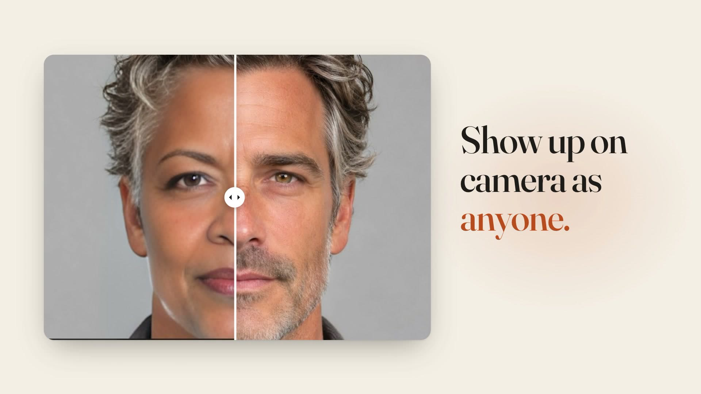
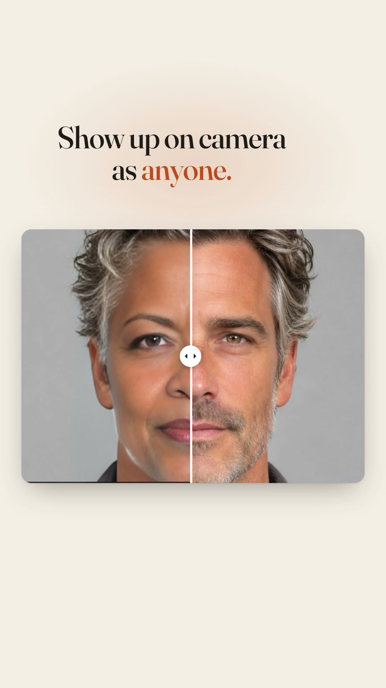

# FaceSwap

FaceSwap is a native Mac app that blurs, pixelates, blacks out or swaps your face live. It adds **FaceSwap Camera**, a virtual camera you can pick in Zoom, Meet, FaceTime, Teams or your browser like any other camera.

**Website and guide:** https://macfaceswap.com/

  
  
   
  <b>▶ Watch the 25-second film:</b> <a href="https://macfaceswap.com/video/faceswap.mp4">landscape</a> · <a href="https://macfaceswap.com/video/faceswap-vertical.mp4">vertical</a>

## Download

**[Download the latest release](https://github.com/mrlynn/FaceSwap-app/releases/latest)**. The DMG is the simplest choice; a ZIP and a PKG installer are there too.

- Needs macOS 14 Sonoma or later on Apple silicon.
- Signed and notarized by Apple.
- Free, with no account.

The Mac app is available now. FaceSwap also runs on iPhone and iPad, but there is no public iPhone or iPad download yet.

## What works out of the box

- **Hide your face:** Blur, Pixelate and Blackout.
- **Look better on calls:** lighting and backgrounds.
- **Call tools:** quick cards, Follow Me, Presenter Mode and hand-sign reactions.
- **Clips and photos:** record up to 30 seconds of what the window shows, with sound, or save a still.

## Face Swap and touch-ups

Swap and the face touch-ups run on machine-learning models that aren't in this download. Their upstream licences only allow non-commercial research, so we can't distribute them publicly yet. Without them, Swap falls back to Blur and everything else works.

We're working on a set of models that anyone can install from inside the app, with no account and no manual steps. Until that's ready, the public download doesn't include swapping.

## Set up the camera for calls

1. Move FaceSwap to `/Applications`. macOS only installs camera extensions from there.
2. Open FaceSwap and allow camera access.
3. Click **Install FaceSwap Camera**, then approve it in **System Settings › General › Login Items & Extensions**, under **Extensions › By Category › Camera Extensions**.
4. Quit and reopen your meeting app, then choose **FaceSwap Camera** as the camera.
5. Keep FaceSwap running. When it isn't, FaceSwap Camera shows a placeholder card.

You don't need the virtual camera to record clips. The [guide](https://macfaceswap.com/docs.html) covers every step and the usual fixes.

## Privacy

FaceSwap processes video on your Mac. It has no account, no analytics and no cloud processing. Your meeting app sends the finished picture, the same as it would from any camera.

The app only goes online for an optional update check, which reads a small version file, and for model downloads you start yourself.

Face replacement hides who you are from casual viewers. It isn't a guarantee of anonymity.

## Feedback

Found a bug or have an idea? [Open an issue](https://github.com/mrlynn/FaceSwap-app/issues).

## About this repository

This repository holds the website (served at macfaceswap.com) and the signed app releases. It doesn't contain the app's source code or any model files.
